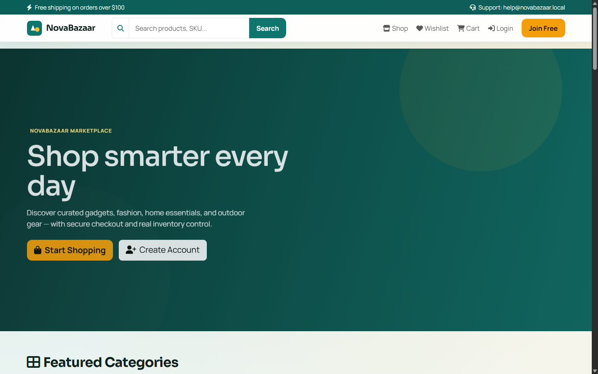
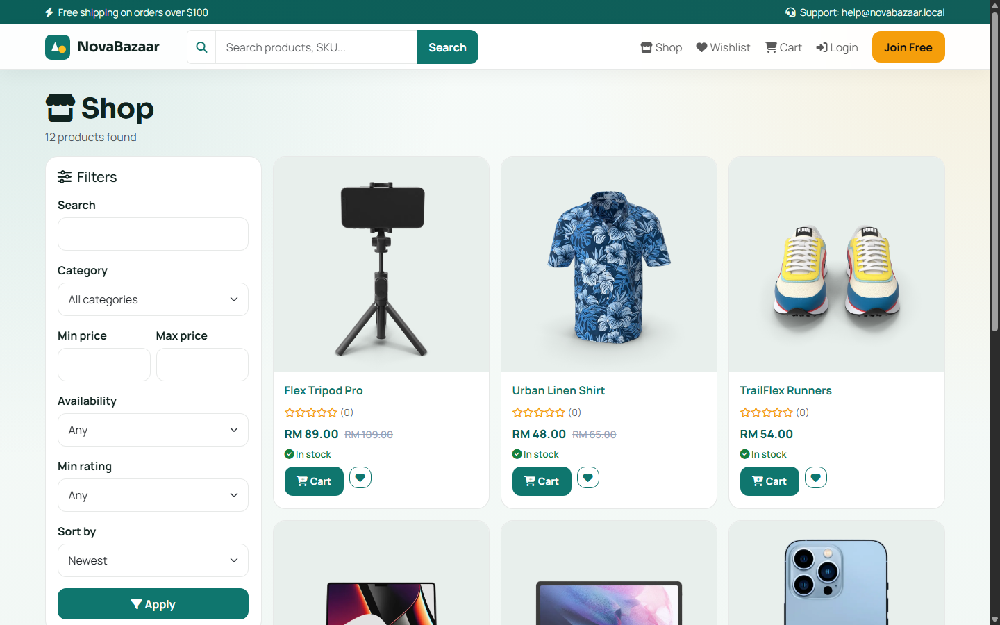
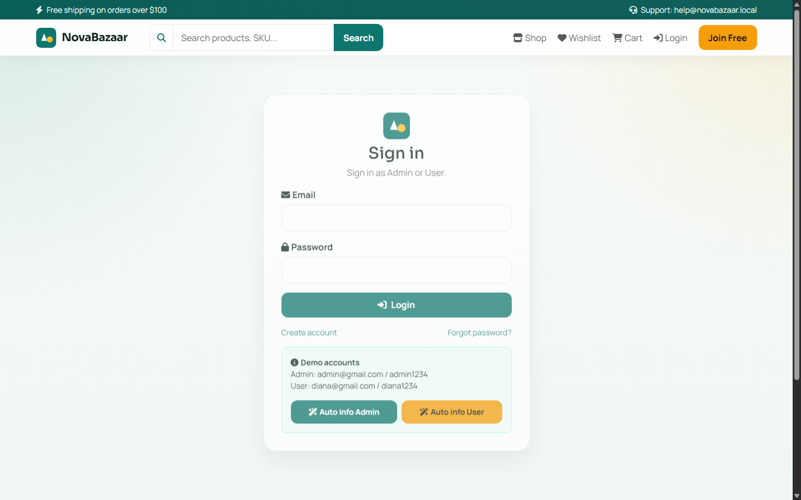
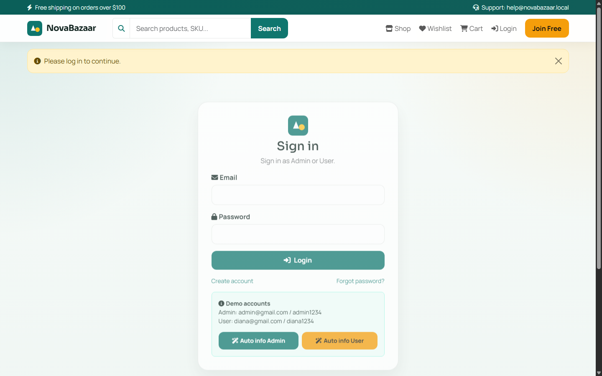

# Screenshots

UI screenshots of the e-commerce website pages (captured from local XAMPP).

| File | Page |
|------|------|
|  | Home |
|  | Shop catalog |
|  | Login |
|  | Shopping cart |

> Tip: replace these images anytime with your own higher-quality captures.
> Keep filenames the same so README links stay valid.
